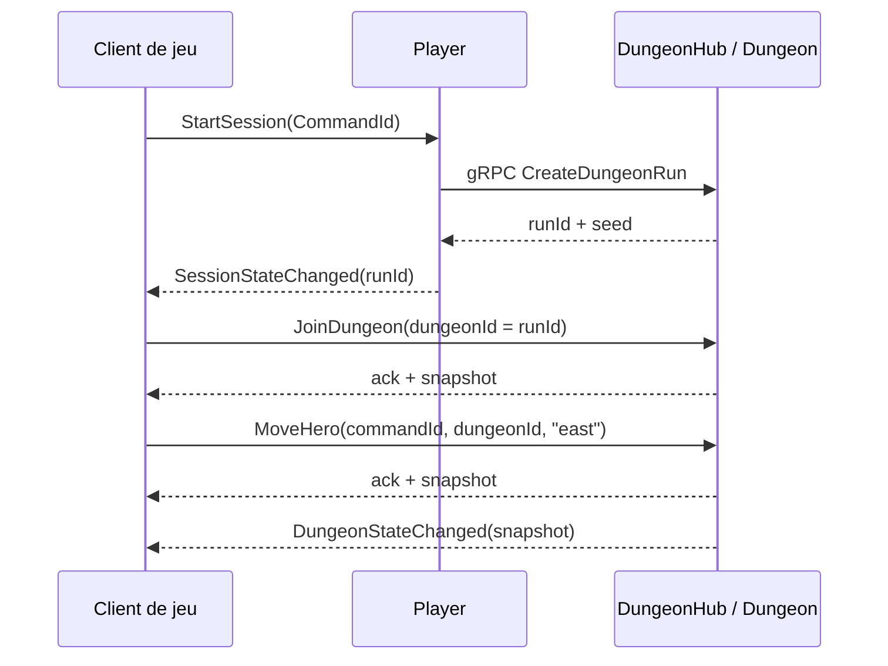

# DungeonHub — contrat SignalR du gameplay Dungeon

> Contrat pour le client de jeu (squad front) et pour les services qui
> démarrent ou font avancer un run (Player, Combat). Référence :
> [ARCHITECTURE_DES_COMMUNICATIONS_MICROSERVICES.fr.md](ARCHITECTURE_DES_COMMUNICATIONS_MICROSERVICES.fr.md) §3.

Tout le gameplay d'un `DungeonRun` passe par le Hub SignalR `DungeonHub`. Les
ancien endpoint REST de gameplay (`POST /api/v1/dungeon-runs/{runId}/moves`) est
**supprimé**. Le REST reste pour ce qui n'est pas du gameplay :
lecture de la carte par seed (cacheable), lecture d'un run, création en
développement et `boss-defeats` en attendant le gRPC Combat.

**Périmètre actuel : solo.** Les groupes existent déjà (`dungeon:{DungeonId}`),
le protocole ne changera donc pas pour le multijoueur. Aucun contrôle de
participant n'est fait pour l'instant : toute connexion qui connaît l'id d'un run
peut le rejoindre. La restriction au roster de la `GameSession` arrivera avec le
multijoueur.

## 1. Connexion

| | Valeur |
| --- | --- |
| Route | `/hubs/dungeons` (via Traefik en WSS ; en local `http://localhost:8080/hubs/dungeons`) |
| Transport | WebSocket (fallback SSE / long polling géré par le client SignalR) |
| Protocole | JSON, propriétés en camelCase, `Guid` en texte |
| Identité | `X-User-Id` injecté par Traefik (ADR-GLOB-004), journalisé uniquement |

```ts
import * as signalR from "@microsoft/signalr";

const connection = new signalR.HubConnectionBuilder()
  .withUrl("/hubs/dungeons", { accessTokenFactory: () => keycloak.token })
  .withAutomaticReconnect()
  .build();

connection.on("DungeonStateChanged", (snapshot) => render(snapshot));
await connection.start();
```

Le client SignalR navigateur ne peut pas poser d'en-tête sur un WebSocket : il
envoie le jeton dans la query `access_token`. La règle Traefik du Hub doit donc
valider le jeton depuis cette query, puis injecter `X-User-Id` comme pour le REST.

En développement, le CORS autorise les origines de `Cors:AllowedOrigins`
(`http://localhost:3000`) avec credentials.

## 2. Méthodes (client → serveur)

Toutes répondent un `DungeonCommandResult` (§4). Une méthode ne lève jamais
d'erreur métier : un refus est une réponse `accepted: false`.

| Méthode | Paramètre | Effet |
| --- | --- | --- |
| `JoinDungeon` | `{ dungeonId }` | Rejoint le groupe `dungeon:{dungeonId}` et renvoie le snapshot courant. Rappeler pour se resynchroniser (après reconnexion, conflit, etc.). |
| `MoveHero` | `{ commandId, dungeonId, direction }` | Une tuile, un tour, puis le tour des mobs. `direction` : `north`, `east`, `south`, `west`. Entrer dans la grille ouverte de la salle du boss fait descendre à l'étage suivant. |

`dungeonId` = `runId` renvoyé par `CreateDungeonRun` (gRPC) ou par
`POST /api/v1/dungeon-runs`.

```ts
const join = await connection.invoke("JoinDungeon", { dungeonId });
if (!join.accepted) throw new Error(join.error.message);
render(join.snapshot);

const move = await connection.invoke("MoveHero", {
  commandId: crypto.randomUUID(),
  dungeonId,
  direction: "east",
});
```

### `CommandId` et retries

Chaque commande porte un `commandId` (UUID) choisi par le client. Si l'ack est
perdu (coupure réseau), **renvoyer la même commande avec le même `commandId`** :
le Hub renvoie la réponse déjà donnée sans rejouer le déplacement. Un nouveau
déplacement = un nouveau `commandId`. Une commande refusée n'est pas mémorisée :
la renvoyer la réévalue. Mémoire : 10 minutes, en mémoire du replica (un seul
replica Dungeon dans le MVP).

## 3. Événement (serveur → client)

| Événement | Payload | Quand |
| --- | --- | --- |
| `DungeonStateChanged` | snapshot (§5) | Après chaque changement accepté : `MoveHero` et `boss-defeats` reçu de Combat. Envoyé à tout le groupe, y compris l'émetteur. |

Le snapshot est complet et autoritatif : le client **remplace** son état, il ne
le patche pas. Recevoir le même snapshot deux fois (ack + événement) est sans
effet.

## 4. `DungeonCommandResult`

```json
{
  "commandId": "0192f1c4-...",
  "accepted": true,
  "error": null,
  "snapshot": { "...": "voir §5" }
}
```

Refus :

```json
{
  "commandId": "0192f1c4-...",
  "accepted": false,
  "error": { "code": "refused", "message": "The hero cannot move to (12, 7): a Wall tile is not walkable." },
  "snapshot": null
}
```

| `error.code` | Équivalent HTTP | Cause | Action client |
| --- | --- | --- | --- |
| `validation` | 422 | `commandId` vide, direction inconnue, id manquant | Corriger la requête |
| `notFound` | 404 | Run inconnu | Revenir au lobby |
| `refused` | 409 | Règle de jeu : mur, eau, lave, grille fermée, pas vers un mob, run terminé, run d'une ancienne version du générateur | Afficher, rien n'a changé |
| `conflict` | 409 | Deux commandes simultanées sur le même run | `JoinDungeon` puis rejouer avec un **nouveau** `commandId` |
| `internal` | 500 | Erreur serveur | Réessayer plus tard |

`commandId` vaut `null` pour `JoinDungeon`.

## 5. Snapshot

Même forme que `GET /api/v1/dungeon-runs/{runId}` :

```json
{
  "id": "0192f1c4-...",
  "gameSessionId": "0192f1c3-...",
  "seed": "0KX4M2T9QZ7PA",
  "generatorVersion": 6,
  "status": "active",
  "floorCount": 4,
  "currentFloor": 0,
  "hero": { "x": 12, "y": 8 },
  "turn": 1,
  "floorBossDefeated": false,
  "currentRoomId": 3,
  "elementsHere": [],
  "mobs": [{ "...": "voir DEPLACEMENT_MOBS.fr.md §7" }],
  "killedMobs": [],
  "startedAt": "2026-10-20T10:00:00+00:00"
}
```

`status` : `active`, `won`, `lost`, `abandoned` (les deux derniers pas encore produits). La carte n'est pas dans le snapshot : la charger une
fois par étage avec `GET /api/v1/dungeons/{seed}/map?floor={currentFloor}`
(immuable, cacheable). Un `enemy` ou `boss` dans `elementsHere` marque l'endroit
où Combat prend la main.

## 6. Pour les autres services

| Squad | Appel | Transport |
| --- | --- | --- |
| Front | `JoinDungeon`, `MoveHero`, écoute `DungeonStateChanged` | SignalR `/hubs/dungeons` |
| Front | Carte d'un étage | REST `GET /api/v1/dungeons/{seed}/map` |
| Player | Démarrer le run d'une `GameSession` → `runId` à transmettre au client | gRPC `DungeonRunService/CreateDungeonRun` ([Dungeon.Contracts](../../Dungeon.Contracts/README.md)) |
| Combat | Victoire sur le boss de l'étage | REST `POST /api/v1/dungeon-runs/{runId}/boss-defeats` (provisoire, sera remplacé par gRPC `ReportCombatResult`). Diffuse `DungeonStateChanged` aux joueurs. |

Séquence solo :



## 7. Pas encore en place

- Autorisation par participant (roster de la `GameSession`) : multijoueur.
- Salles et coffres (`OpenChest` → gRPC `GrantChestReward`).
- gRPC `ReportCombatResult` et `AbandonDungeonRun`.
- Backplane Redis : un seul replica Dungeon.
